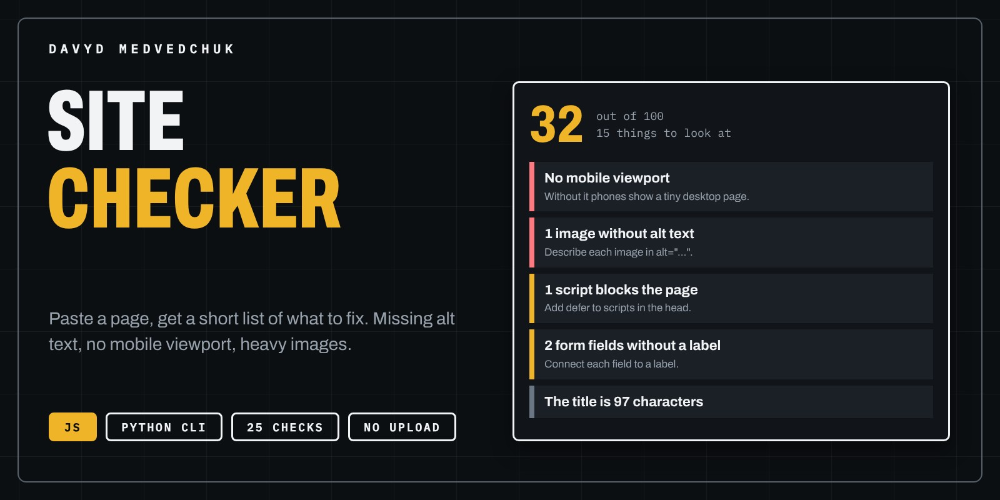

# Site checker



> **Test version.** This app is live, but I have not checked it myself yet. If you want to use it, keep that in mind.

Point it at a page, get a short list of what to fix. Missing alt text, no mobile viewport, heavy images, scripts that block the page. Plain words, worst problems first, and a score out of 100.

**[Open the web page](https://davydmedvedchuk.github.io/site-checker/)** (paste the page's HTML) · or use the command line, which can fetch a site by itself.

## Two ways to use it

**Web page.** Open the page you want to check, press Ctrl+U (View source), copy everything, paste it in. The check runs in your browser and nothing is sent anywhere. A web page cannot download another site (browsers forbid it), which is why you paste the HTML.

**Command line (Python 3.9+, no packages).**

```
python3 cli/sitecheck.py https://your-site.pt
python3 cli/sitecheck.py page.html --url https://your-site.pt/    # a saved file
python3 cli/sitecheck.py https://your-site.pt --json               # for scripts
```

Giving it a web address also turns on the live checks: download time, compression, HTML weight, and every image is weighed.

## Security mode (your own sites)

Tick "Also check security" on the page, or add `--security` on the command line. It is passive: it reads the page code you gave it and, on the command line, the headers of the one address you typed. It does not scan, guess paths or send test attacks, so use it only on sites you own.

| Level | Checks | Where |
|---|---|---|
| Fix first | a form that sends data over http | both |
| Should fix | scripts or styles from other sites without an `integrity` attribute; no `Strict-Transport-Security`; the page can be put in a frame by other sites | both / CLI |
| Nice to have | links with `target="_blank"` without `rel="noopener"`; inline `onclick` code; embeds without `sandbox`; a generator tag with a version; no Content-Security-Policy, `nosniff` or Referrer-Policy; the server announces its version | both / CLI |

Header checks need the command line, because a web page cannot read another site's headers.

## What it checks

| | Checks | Where |
|---|---|---|
| Fix first | no title, no mobile viewport, images without alt text, http resources on an https page, images that return 404 | both / CLI |
| Should fix | no meta description, no `lang`, images without width and height, scripts in the head without `defer`, links with no text, form fields without a label, page served over http, slow download, huge HTML, no compression, images over 300 KB | both / CLI |
| Nice to have | long title or description, several `h1`, jumping heading levels, images without `loading="lazy"`, no canonical link, incomplete link preview (og tags), no favicon | both |

The score is 100 minus 12 for each kind of "fix first" problem, 5 for "should fix", 1 for "nice to have". It is a rough guide, not a standard.

## Tests

The two versions are written separately, so a test makes sure they agree: the same three pages must give the same list of problems in Python and in the browser (Chromium via Playwright).

```
python3 tests/test_parity.py     # Python vs JavaScript on tests/fixtures
python3 tests/test_live.py       # throwaway local server: heavy image, missing image, no compression
```

## Limits

- Security mode finds common slips, it is not a security audit. A clean result does not mean a site is safe.
- On GitHub Pages you cannot set response headers, so the header checks will always flag a site hosted there. That is expected.

- It reads the HTML you give it. It does not run JavaScript, so a page built entirely in the browser (many single-page apps) looks nearly empty to it.
- It does not measure real speed on a phone, only the download of the HTML and the weight of images. For that use Lighthouse.
- Accessibility checks are a starting point: alt text, labels, link text, heading order. They do not replace testing with a screen reader.
- The live checks look at up to 30 images.

Made by Davyd Medvedchuk. MIT licence. Fonts: Archivo and IBM Plex Mono (SIL OFL 1.1), served from this repository.
